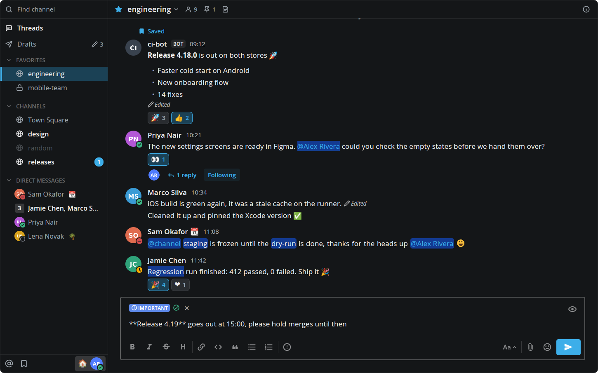

# Mattermost for Herdr

A [Herdr](https://herdr.dev) mod that puts your Mattermost team in a panel beside your terminals, drawn like the Mattermost desktop app. It has the channel sidebar with your categories, unreads and statuses, and live channels with markdown, images, GIFs, bot attachments, link previews, threads, reactions, the emoji picker, Find Channels, inline editing with the same formatting bar, drafts, the post menu, Recent Mentions, Saved messages, your status and custom status, your profile, Mattermost's suggestions as you type (`@` people and groups, `~` channels, `:` emoji, `/` commands), and its message box with the formatting bar and shortcuts, message priority, file uploads and preview. Videos play in `mpv`, in their own window, because Herdr can't play them inside a panel.


## Install

Ask your agent in Herdr:

```text
Read ~/.config/herdr-app/AGENTS.md, then add the mod at https://github.com/dev-gvs/herdr-mattermost
```

Or by hand:

1. Copy `mods/mattermost/` into `~/.config/herdr-app/mods/`.
2. Open it as a pane (`herdr-app do pane.split --direction right --mod mattermost`), or add a block for it to a layout you own (see [RECIPE.md](RECIPE.md#built-from)).
3. Run `herdr-app check ~/.config/herdr-app/mods/mattermost`.

## Login

The first time it opens, the panel asks for your server's address and a personal access token, checks them, lets you pick a team if you're in several, and saves them to `~/.config/herdr-app/mattermost.json`, readable only by you.

To get a token, open Profile → Security → Personal Access Tokens → Create Token in Mattermost ([how to](https://docs.mattermost.com/developers/integrate/reference/personal-access-token)). If that section isn't there, an admin has to enable personal access tokens and allow your account to create them; the same page shows where.

You can also write the file yourself and `chmod 600` it:

```json
{ "url": "https://chat.example.com", "token": "<token>", "team": "<team name>" }
```

To try it without a server, give the block `"props": { "demo": true }`. It shows a made-up team and nothing reaches the network.

## Links

Links to your server clicked in the panel (permalinks, channels, direct messages, threads) open in the panel, as they do in the Mattermost app. Other pages on the server, such as sign-in or `/emoji`, and links you can't open here (another team, a channel you aren't in, a deleted post) go to the browser.

### `mattermost://` links

`handler/` has an optional handler for `mattermost://` links. With the Herdr window running and the panel shown, the link opens in the panel and the window comes forward. Otherwise, or when the panel can't show it, the link goes to the Mattermost desktop app as before. It never goes to the browser, which may be where the link came from. Install it:

```sh
install -Dm755 handler/herdr-mattermost-link ~/.local/bin/herdr-mattermost-link
mkdir -p ~/.local/share/applications
sed "s|^Exec=.*|Exec=$HOME/.local/bin/herdr-mattermost-link %u|" handler/herdr-mattermost-link.desktop > ~/.local/share/applications/herdr-mattermost-link.desktop
xdg-mime default herdr-mattermost-link.desktop x-scheme-handler/mattermost
```

Uninstall it:

```sh
xdg-mime default mattermost-desktop.desktop x-scheme-handler/mattermost
rm ~/.local/bin/herdr-mattermost-link ~/.local/share/applications/herdr-mattermost-link.desktop
```

If your desktop app's `.desktop` file isn't `mattermost-desktop.desktop`, set `HERDR_MM_DESKTOP` to its name in the `Exec` line (`Exec=env HERDR_MM_DESKTOP=… …`). A panel in a Herdr tab that isn't shown isn't running, so its links go to the desktop app.

### Links in the browser

The Mattermost web app sends a link to the desktop app only from its "View in Desktop App" page. That page appears once per browser, on the first visit, and only when the server has a desktop app download link and `EnableDesktopLandingPage` on. To send conversation links from the browser to the panel every time, use a redirect add-on such as [Redirector](https://addons.mozilla.org/firefox/addon/redirector/) with this rule. Replace `<server>` with your server's host, with its dots escaped in the pattern (`chat\.example\.com`):

- Include pattern: `^https://<server>/([a-z0-9_-]+/(?:pl|channels|messages|threads)(?:/[^?#]*)?)(?:[?#].*)?$`
- Redirect to: `mattermost://<server>/$1`
- Pattern type: Regular Expression
- Apply to (advanced options): Main window (address bar) only

Sign-in, `/api`, `/files`, scripts and other pages don't match, so they stay in the browser. Caveats:

- Firefox asks once which application opens `mattermost` links. Pick "Mattermost in Herdr" (or the system handler) and tick "Always". If you chose the desktop app there before, change it in Settings → General → Applications → mattermost.
- The rule also catches the web app opened at a conversation's address, by a bookmark, a reload or a new tab, so while it's on the web app won't open at those addresses in that browser. Moving around inside the web app doesn't load a page, so it isn't affected.
- With the rule on, links the panel leaves to the browser for a conversation it can't show (a channel you aren't in, another team) come back to the handler and open in the desktop app.

## Privacy

- The token goes only to your Mattermost server: the API, the websocket and the downloads of its files.
- `curl` reads the token from `~/.config/herdr-app/data/mattermost/private/curl.conf`, readable only by you. Log out in the account menu deletes it along with `mattermost.json`. The token stays valid until you revoke it in Mattermost, so revoke it there if it may have leaked.
- Webhook icons, images in messages and link preview pictures from other hosts are downloaded without the token. Those hosts see your address, as they would in a browser.
- Avatars, emoji, images and attachments are cached in `~/.config/herdr-app/data/mattermost/`. Files you open stay there for two weeks, and pictures from other hosts for 30 days.
- Unsent drafts stay in `~/.config/herdr-app/data/mattermost/`, readable only by you. When your server allows synced drafts they also go to it, as the web app's do.
- Attaching files to a message uses `kdialog` or `zenity` (or a drop on the box). The files go to your Mattermost server through `curl`.
- Choosing a profile picture uses `kdialog` or `zenity` if you have one. The picture goes to your Mattermost server and a temporary copy stays in `~/.config/herdr-app/data/mattermost/private/` until the section closes.
- Save Image copies the file into your downloads folder. Save Image As… asks where through `kdialog` or `zenity` if you have one.
- The mod runs `curl` for downloads, `xdg-open` for links and files, `herdr-app` to bring the window forward for a `mattermost://` link, `wl-copy` for Copy Image and `wl-paste` for pasting images and files (Wayland only). `ffmpeg`, `ffprobe` and `mpv` are optional: they add video posters, GIF stills, pictures on the cards of files you attach before the server has them, the limits on GIF memory and image size, and playback (without `mpv`, video opens in your default player).

## Jira notifications (optional)

The panel can also show your Jira Cloud notifications, like Jira's bell: a Jira row under Threads with the unread count, and a page with Direct and Watching tabs, Only show unread, and a row per notification drawn as Jira draws it: the issue or page, its status or space, the comment, and the group of updates behind it, which a click opens. A click on a row opens the issue or page in the browser and marks it read, the dot on the right marks it read or unread, and ⋮ marks the whole tab read. It's off unless you add a `jira` block to the panel's props:

```json
"props": { "jira": { "site": "https://your-site.atlassian.net", "credentials": "~/.config/jira.conf" } }
```

`credentials` is an INI file with your Atlassian account's email and an [API token](https://id.atlassian.com/manage-profile/security/api-tokens). `chmod 600` it:

```ini
[jira]
email = you@example.com
token = <API token>
```

The token is read from that file for each request and goes only to your Jira site. It never goes in props, the panel's own files or its log. Issue type icons on your site are downloaded with it, as Jira's own page does; actors' pictures and icons on other hosts are downloaded without it. With `"demo": true`, any `jira` value shows made-up notifications.


[RECIPE.md](RECIPE.md) is the full brief for building or changing it.

## Screenshots

A thread beside the channel:


Threads:


Images, GIFs and files in messages:


The image viewer and its right-click menu:


Recent Mentions and its filters:


The message box with its formatting bar and a message priority:



Suggestions while typing:


The account menu:


Profile:


## License

MIT, see [LICENSE](LICENSE). The line icons in `mods/mattermost/icons/` are from [Lucide](https://lucide.dev) under the ISC license ([LICENSE-lucide](mods/mattermost/icons/LICENSE-lucide)). The icons in `mods/mattermost/icons/compass/` are Mattermost's [Compass Icons](https://github.com/mattermost/compass-icons) under the MIT license ([LICENSE-compass](mods/mattermost/icons/compass/LICENSE-compass)). The file-type icons in `mods/mattermost/icons/files/` are from Mattermost's web app under the Apache License 2.0 ([LICENSE-mattermost](mods/mattermost/icons/files/LICENSE-mattermost)). The Mattermost name and logo are trademarks of Mattermost, Inc.; this project is not affiliated with it.
