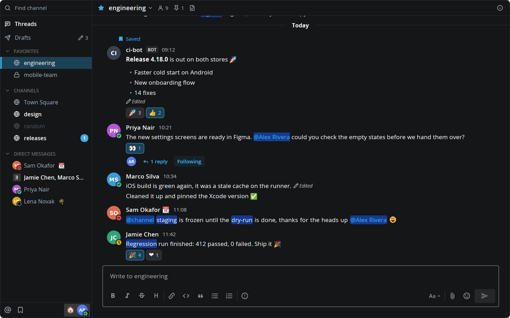
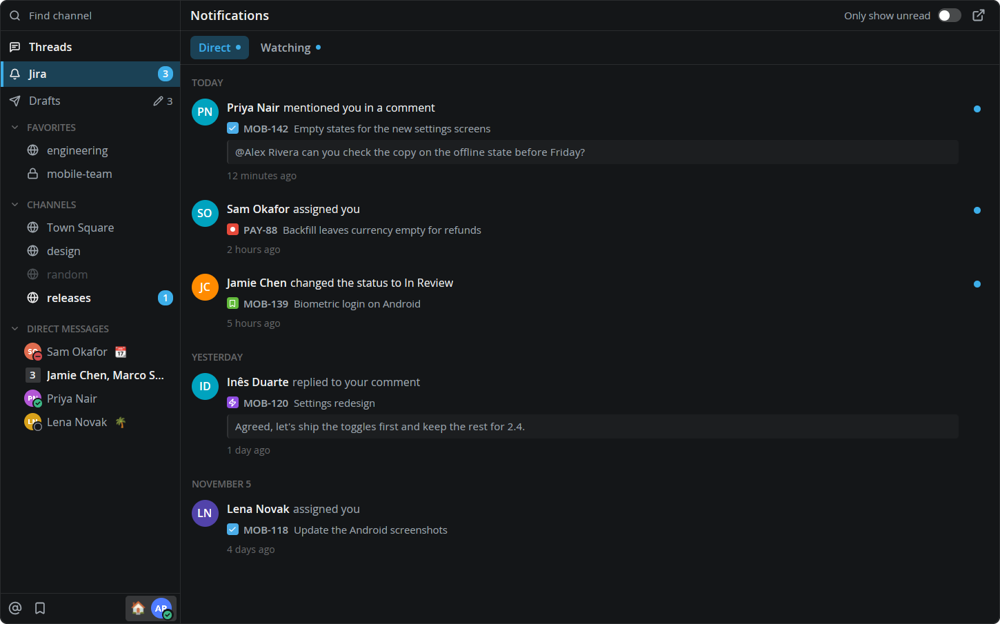
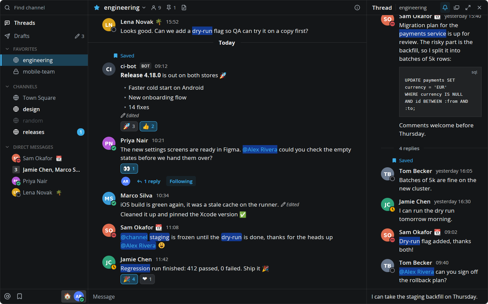
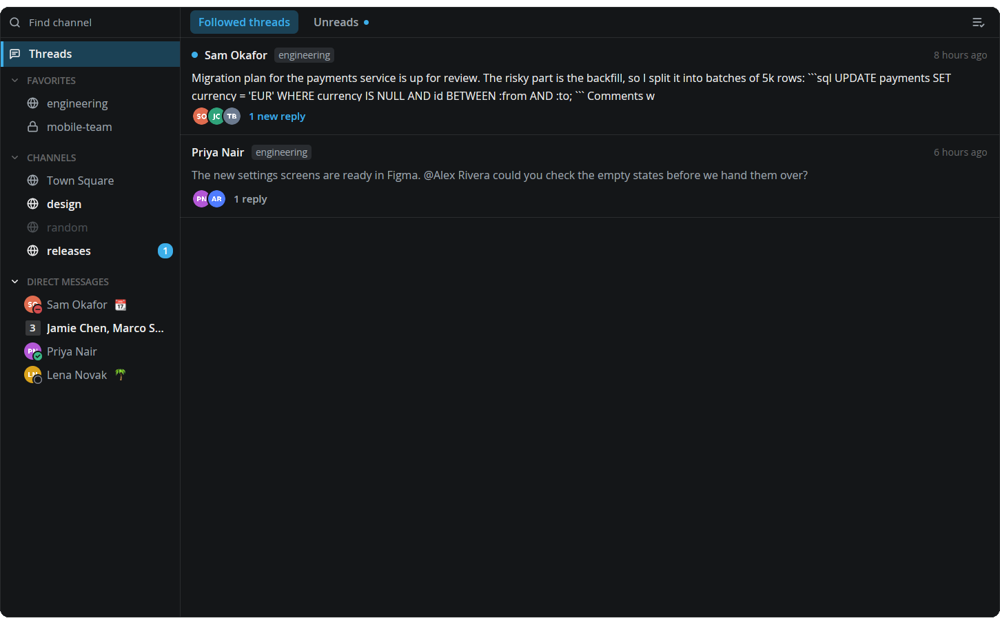
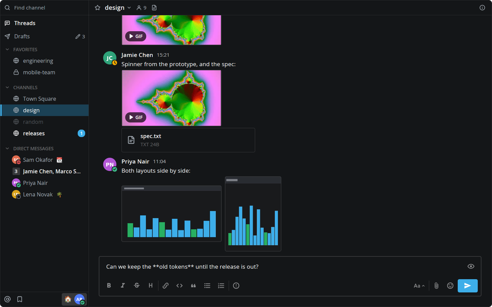
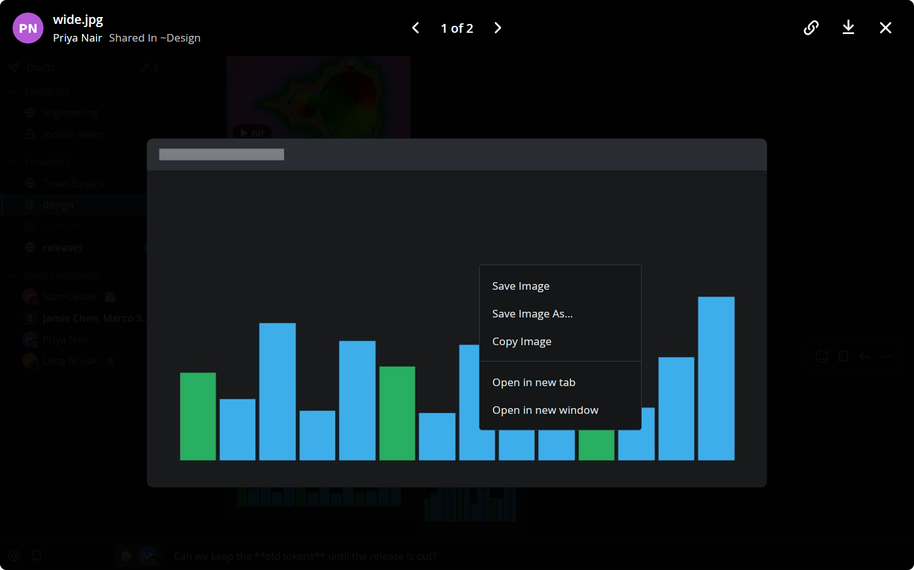
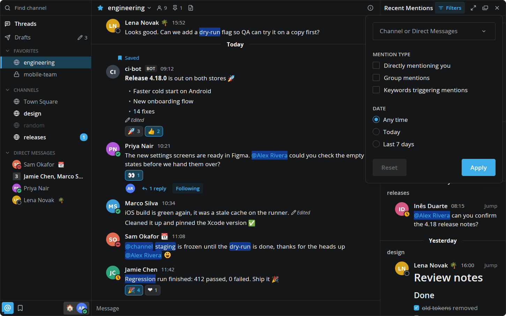
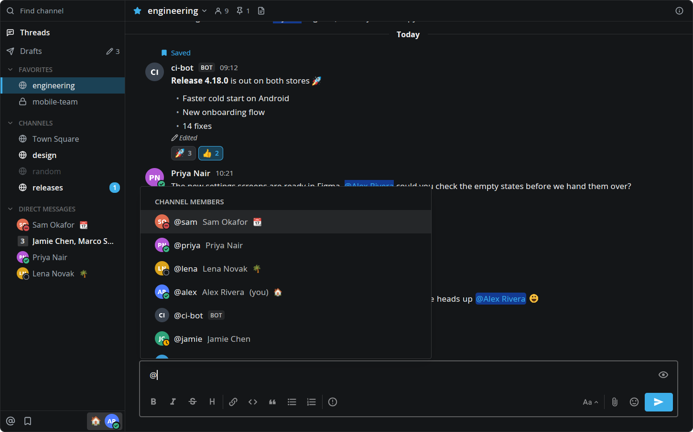
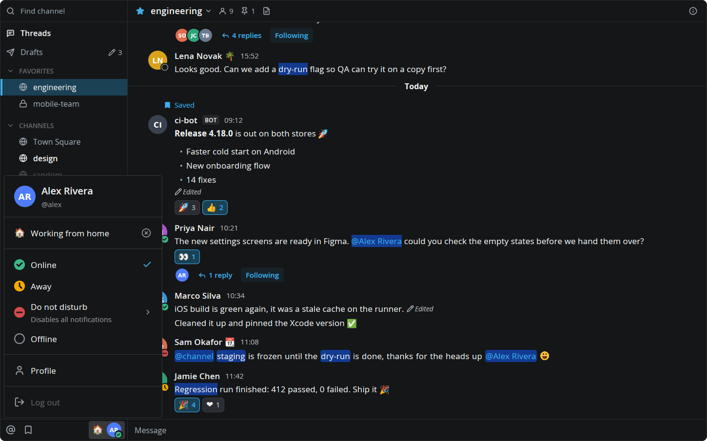
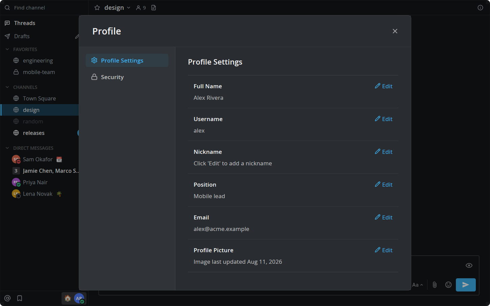

# Mattermost for Herdr

A [Herdr](https://herdr.dev) mod that puts your Mattermost team in a panel beside your terminals, drawn like the Mattermost desktop app. It has the channel sidebar with your categories, unreads and statuses, and live channels with markdown, images, GIFs, bot attachments, link previews, threads, reactions, the emoji picker, Find Channels, inline editing, drafts, the post menu, Recent Mentions, Saved messages, your status and custom status, your profile, and Mattermost's suggestions as you type (`@` people and groups, `~` channels, `:` emoji, `/` commands). Videos play in `mpv`, in their own window, because Herdr can't play them inside a panel.



## Install

Ask your agent in Herdr:

```text
Read ~/.config/herdr-app/AGENTS.md, then add the mod at https://github.com/dev-gvs/herdr-mattermost
```

Or by hand:

1. Copy `mods/mattermost/` into `~/.config/herdr-app/mods/`.
2. Open it as a pane (`herdr-app do pane.split --direction right --mod mattermost`), or add a block for it to a layout you own (see [RECIPE.md](RECIPE.md#built-from)).
3. Run `herdr-app check ~/.config/herdr-app/mods/mattermost`.

## Login

The first time it opens, the panel asks for your server's address and a personal access token, checks them, lets you pick a team if you're in several, and saves them to `~/.config/herdr-app/mattermost.json`, readable only by you.

To get a token, open Profile → Security → Personal Access Tokens → Create Token in Mattermost ([how to](https://docs.mattermost.com/developers/integrate/reference/personal-access-token)). If that section isn't there, an admin has to enable personal access tokens and allow your account to create them; the same page shows where.

You can also write the file yourself and `chmod 600` it:

```json
{ "url": "https://chat.example.com", "token": "<token>", "team": "<team name>" }
```

To try it without a server, give the block `"props": { "demo": true }`. It shows a made-up team and nothing reaches the network.

## Privacy

- The token goes only to your Mattermost server: the API, the websocket and the downloads of its files.
- `curl` reads the token from `~/.config/herdr-app/data/mattermost/private/curl.conf`, readable only by you. Log out in the account menu deletes it along with `mattermost.json`. The token stays valid until you revoke it in Mattermost, so revoke it there if it may have leaked.
- Webhook icons, images in messages and link preview pictures from other hosts are downloaded without the token. Those hosts see your address, as they would in a browser.
- Avatars, emoji, images and attachments are cached in `~/.config/herdr-app/data/mattermost/`. Files you open stay there for two weeks, and pictures from other hosts for 30 days.
- Unsent drafts stay in `~/.config/herdr-app/data/mattermost/`, readable only by you. When your server allows synced drafts they also go to it, as the web app's do.
- Choosing a profile picture uses `kdialog` or `zenity` if you have one. The picture goes to your Mattermost server and a temporary copy stays in `~/.config/herdr-app/data/mattermost/private/` until the section closes.
- Save Image copies the file into your downloads folder. Save Image As… asks where through `kdialog` or `zenity` if you have one.
- The mod runs `curl` for downloads, `xdg-open` for links and files, and `wl-copy` for Copy Image (Wayland only). `ffmpeg`, `ffprobe` and `mpv` are optional: they add video posters, GIF stills, the limits on GIF memory and image size, and playback (without `mpv`, video opens in your default player).

## Jira notifications (optional)

The panel can also show your Jira Cloud notifications, like Jira's bell: a Jira row under Threads with the unread count, and a page with Direct and Watching tabs, Only show unread, and a row per notification. A click opens the issue in the browser and marks it read, and the dot on the right marks it read or unread. It's off unless you add a `jira` block to the panel's props:

```json
"props": { "jira": { "site": "https://your-site.atlassian.net", "credentials": "~/.config/jira.conf" } }
```

`credentials` is an INI file with your Atlassian account's email and an [API token](https://id.atlassian.com/manage-profile/security/api-tokens). `chmod 600` it:

```ini
[jira]
email = you@example.com
token = <API token>
```

The token is read from that file for each request and goes only to your Jira site. It never goes in props, the panel's own files or its log. Actors' pictures are downloaded without it. With `"demo": true`, any `jira` value shows made-up notifications.



[RECIPE.md](RECIPE.md) is the full brief for building or changing it.

## Screenshots

A thread beside the channel:



Threads:



Images, GIFs and files in messages:



The image viewer and its right-click menu:



Recent Mentions and its filters:



Suggestions while typing:



The account menu:



Profile:



## License

MIT, see [LICENSE](LICENSE). The line icons in `mods/mattermost/icons/` are from [Lucide](https://lucide.dev) under the ISC license ([LICENSE-lucide](mods/mattermost/icons/LICENSE-lucide)). The Mattermost name and logo are trademarks of Mattermost, Inc.; this project is not affiliated with it.
