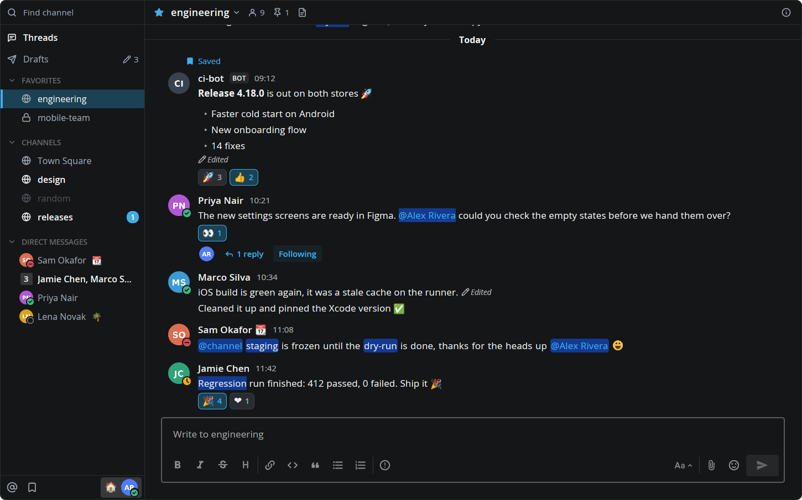

# Mattermost

Your Mattermost team inside Herdr, drawn like the Mattermost desktop app: the channel sidebar with your categories, unread counts and people's statuses on the left, and the open channel on the right, with threads, reactions, the emoji picker, Find Channels and the post menu. It stays live through Mattermost's websocket, so it sits beside your terminals and agents instead of in another window.



This file is the brief: enough to build the Mattermost panel from an empty folder. The files next to it are one build of it. If they don't work on your Herdr, or you want it different, build it again from here.

## What you see

The panel follows the Herdr theme (`background`, `foreground`, `accent`, `border`, `selected`, `hover`). Mattermost's tints are the text color at an alpha (`rgba(center-channel-color, a)` becomes `foreground` plus a two-digit alpha). The text is Open Sans, 13px in the sidebar and 14px in messages, with 20px lines.

- **Before there's a login**, the panel is a setup form centered in a 420px column: the Mattermost logo (28px) and "Connect to Mattermost" (18px semibold), then two 34px text boxes with 12px semibold labels:
  - **Server URL**, hinted "The address you open Mattermost at in a browser."
  - **Personal access token**, drawn as dots, hinted "In Mattermost: Profile → Security → Personal Access Tokens → Create Token." with a "How to create one" link in `accent` to Mattermost's personal access token docs.
  - A `dim` note that an admin has to turn tokens on (System Console → Integrations → Integration Management) and allow the account to create them, a 34px `accent` Connect button, and where the login is saved. Errors show under it in `blocked`.
  - When the account is in more than one team, the form becomes a list of its teams (display name, with the URL name in `dim`) and a Back button.
- **Wide (620px and up): two columns** split by a draggable divider. The sidebar starts 260px wide (180–480) and the width you drag is remembered. Narrower than 620px, the panel shows the sidebar until you pick a conversation, then the conversation with a ‹ back button.
- **The sidebar**, edge to edge, every icon in a 16px slot centered 17px from the edge:
  - A 36px **Find channel** bar with a search icon. The whole bar is a button that opens Find Channels. In the framed panel its top-left corner is rounded to the frame (9px).
  - **Threads**, 30px, with the unread-mention badge.
  - **Drafts**, 30px, under Threads: a send icon, the name, and a 12px pencil with the count on the right. It shows only while there are drafts or its page is open.
  - **Categories** as the server orders them (Favorites, Channels, custom ones, Direct Messages). Each has an 11px semibold uppercase heading with a chevron; hovering lights the name and the chevron together. Collapsed categories still show unread channels and the open one.
  - **Channel rows**, 30px: a globe (public), lock (private), avatar with status ring (direct message) or a numbered square (group: an 18px square, 12px semibold count, radius 2). Read rows are the text color at 64%, unread rows full and semibold, muted rows 40%. A mention badge sits on the right: an `accent` pill with an 11px count. The open channel has a `selected` background and a 3px `accent` bar on the left edge. Direct messages are limited to the server's "number of direct messages to show" preference (40 by default), plus unread ones.
  - A ⋯ button shows on hover: Mark as Read/Unread, Favorite, Mute Channel, Move to… › (Favorites first, then your categories and New Category; channels can't go under Direct Messages nor conversations under Channels), Copy Link, and Leave Channel or Close Conversation.
  - Category headings have their own ⋯ menu: Mark category as read, Mute Category, Rename Category and Delete Category (custom ones), Sort › (alphabetically, recent activity, manually), Create New Category.
  - The Direct Messages heading's menu is Sort ›, Show › (10, 15, 20 or 40) and Open a direct message, which searches people.
- **The channel header**, 36px like the Find channel bar: a star (favorite, `accent` when on), the name with a ▾ menu, the member count, the pinned count and a files icon, each of which opens the right-hand panel, and an ⓘ on the far right. In a direct message the name carries the person's status and custom-status emoji, and its menu is View Info, Mute, Edit Header, Move to ›, Close Direct Message.
- **Messages**, newest at the bottom:
  - A post is a 53px avatar column (32px avatar, status ring at its bottom right) and the content: the name in 14px semibold, the custom-status emoji (hover it for the status text and when it clears), a BOT tag for bots (10px semibold on an 8% pill), and the time in 12px at 73%. A post within 5 minutes of the same person's previous one leaves the header out.
  - The text is markdown: headings, bold, italics, strikethrough, lists, task lists, tables, links, quotes and code blocks. Images in the text (``) are drawn as blocks between the text around them. A line holding a custom emoji is laid out word by word with its bold, italics, code and links kept; everything else stays selectable text. Standard emoji are Mattermost's own images, and a message of only emoji (up to 8) is drawn at 32px. @mentions are links, and your own name, @channel, @all and @here get the Mattermost theme's mention highlight (Indigo's `#133a91` until your theme preference says otherwise).
  - An edited post carries Mattermost's indicator: a 12px pencil and "Edited" in 11px italic at 75%, with when it was edited in a tooltip ("Edited today at 14:38"). It follows the last line when the message ends in a paragraph, and starts a line of its own after a list, quote, heading, rule, table or code block, or when the text is empty. TextView can't hold it, so that last line is a block of its own, and a selection stops there. A last line that wraps also puts the label on a line of its own, since nothing tells the mod where the wrapped line ends; Mattermost keeps it on the last wrapped line when it fits.
  - Reactions are 24px pills: the emoji at 16px and a count, `accent` bordered when one of them is yours. Hover shows who reacted.
  - Attached images are drawn up to 350px tall and as wide as the column; several in one post share the row at up to 240×180. Clicking one opens it in a viewer at its own size, shrunk only to fit, with a button for opening the original in another app.
  - GIFs and animated images show a still with a ▶ GIF badge. A click plays one, a second click stops it, and only one plays at a time.
  - Videos show their first frame with a play button, the name and the size. A click downloads the file ("Downloading…") and plays it in `mpv`, in its own window with sound and seeking. Audio does the same from a file row.
  - Other files are a row with an icon, the name, the type and the size; a click downloads the file and opens it with the system's app.
  - Bot and webhook attachments are cards with a coloured bar (`good`, `warning`, `danger` or any color): pretext above, then author, title, text in markdown, short fields two to a row, image, thumbnail and footer.
  - Link previews are cards with the site, title, description and picture (full width from 480px wide, else a 75px thumbnail). Links to images are drawn as images. Links to posts are quoted with the author, the text and "Originally posted in ~channel".
  - A thread root has a footer: up to 3 participant avatars (latest first, +N beyond), "N replies" in `accent`, a Follow/Following toggle and, on hover, "Last reply 2 hours ago".
  - Date separators ("Today", "Yesterday", "October 23") sit on the boundary between two posts, 26px tall, a 13px bold label on a line.
  - Saved posts have a "Saved" label with a bookmark above the header.
  - Join and leave messages are hidden unless your Mattermost settings show them.
- **Hovering a post** gives it a 4% background, an add-reaction button after its reactions, and a 28px action bar over its top right corner (top −12px, 4px padding, a border at 20%, `shadow_md`): emoji picker, save, reply, ⋯.
- **The post menu (⋯)**, 28px rows: Reply, Follow/Unfollow thread, Mark as Unread, Remind › (30 mins, 1 hour, 2 hours, Tomorrow at 9:00), Save Message, Pin to Channel, Copy Link, then Edit (your own posts), Copy Text and Delete (your own). Submenus open on hover and flip leftwards near the right edge.
- **The message box**, 34px with radius 8 and an `input` border, 10px from the panel's edges. Enter sends. Each channel and thread keeps its own text, so the box opens on that conversation's draft. A draft with line breaks shows joined, with a note above the box that editing it here removes them, and a draft holding files says it sends with them.
- **Suggestions** open over the message box, the thread reply boxes and the edit box as you type, in a card up to 496×292 at the box's left edge (radius 4, a border at 16%, `shadow_lg`), 4px above it and as wide as the box when that's narrower. Uppercase 12px semibold group headings sit in 28px with 12px above, and every group after the first has a line at 8% over its heading. Rows are 40px (commands 57px), the selected one at 8%. Going by the text before the caret:
  - **`@`** after the start or a non-word character, then letters, digits, `-`, `_`, `.` or spaces: Channel Members (in a thread its authors first, then those starting with what you typed, then by your direct message's last view, then by name), Agents, Group Mentions with a member count, Special Mentions (@here, @channel, @all, only with `use_channel_mentions`) and Not in Channel. A row has the avatar with status, `@name`, a BOT, AGENT or GUEST tag, the full name and nickname, "(you)" and the custom status emoji. Names match on any part: the username split at `.`, `-` and `_`, first, last and nick names, ignoring accents. Until the server first answers for a channel, those who wrote in it stand in for its members. An "Other Members" group shows "Loading…" when the server takes over 500ms.
  - **`~`** after a non-word character: My Channels (your public ones at once, your private ones when the server answers), then Other Channels with "Loading…" until it does. Every typed word has to start a word of the name. With `DelayChannelAutocomplete` it waits for 2 characters.
  - **`:`** with 2 characters after the start, a space or a leading `+` or `-`: emoji containing the text, your recent ones first, then those starting with it, standard before custom, `:thumbsup:` before `:thumbsdown:`. A skin tone's variants show only when it's your tone. Typed faces such as `:)` and `:-o` open nothing. A standard emoji goes in as its character, a custom one as `:name:`.
  - **`/`** at the very start of a message (not in the edit box): the server's commands and, as you go on, their arguments. Past a full command an "Execute Current Command" row comes first.
  - Up and down move through the rows without wrapping, hovering selects, and Enter, Tab or a click put the selected one in with a space after it. A completed command asks for its next level at once. Esc closes the list and leaves the text. Ctrl+Enter sends, list or not.
  - The lookup waits for 100ms of quiet. A prefix that found nothing isn't asked again while you keep typing past it, and a name you just completed doesn't reopen the list.
- **Editing** happens in place: the post becomes a text box with "ENTER to Save, ESC to Cancel" and Save / Cancel buttons (32px). Shift+Enter adds a line.
- **The right-hand panel**, 360px (280–640) beside the messages when there's room for 420px of messages, otherwise over them: channel or person info, members, pinned messages, files, or a thread with its own reply box.
- **Threads**: Followed threads / Unreads tabs and a mark-all-read button. Each card shows the author, the channel, the time, two lines of the root, participants and "N replies" or "1 new reply" in `accent`, with a ⋮ menu on hover. Opening a thread keeps the list on the left (420px) when the panel is wide enough.
- **Drafts**: "Drafts" and "Any messages you've started will show here" in the top bar, then a card per draft, newest first. A card has a 36px header ("In:", "To:", "Thread in:" or "Thread to:", the conversation's icon and name, the time, a red DRAFT tag), then the avatar, the name, the message in markdown and any attachment count. Hovering a card covers the time and tag with delete, edit and send. Delete and send ask in the header first. A click on the card or on edit opens the conversation with the draft in its box, a thread beside its channel. Without drafts the page says "No drafts at the moment".
- **Find Channels** is a 600×520 dialog: "Type to find a channel. Use UP/DOWN to browse, ENTER to select, ESC to dismiss." With no text it lists UNREAD (up to 5, Threads first when it has unread threads) and RECENT (up to 20 by last view). Typing searches your conversations, the team's public channels and people, ranked as Mattermost's quick switcher ranks them.
- **The emoji picker** is a 360×432 popup: search, 11 category tabs, recently used (shared with the official apps), every standard emoji and the server's custom emoji, a preview footer and a Custom Emoji button that opens the server's emoji page.

## How it behaves

- **Live updates**: the websocket's events update the panel in place: new, edited and deleted posts, reactions, read state, unread marks, statuses, channel and sidebar category changes, preferences and thread changes. On reconnect it reloads, since missed events are gone. The panel header shows "reconnecting" while it's down.
- **Drafts**: typed text is kept per channel and per thread and written to `localStorage` each second, so it survives a restart. A draft is filed when you leave it (another conversation, closing the thread, opening Threads or Drafts), and only then does it count and go to the server, as in Mattermost. Drafts sync with the web app while the server has `AllowSyncedDrafts` on and the person hasn't turned `sync_drafts` off, through `draft_created`, `draft_updated` and `draft_deleted` events and a reload on reconnect; otherwise they stay on this machine. Text here that hasn't reached the server outranks the server's copy, and a saved draft the server no longer lists is gone. A failed save is retried at the next load. A post the server refuses goes back to being a draft, with the error shown.
- **Statuses** (online, away, do not disturb, offline) come from `status_change` events and a poll each minute of the people shown, as Mattermost's own client does.
- **Opening a channel** marks it read, loads 60 posts and focuses the message box at once. Scrolling up loads 60 older at a time. A channel whose posts aren't loaded yet keeps the previous one on screen for up to 500ms while they load, and the sidebar marks the new one immediately. The last 10 channels' posts stay in memory.
- **Keyboard**: a click in the panel takes the keyboard, like a pane. If the message box has it, the box keeps it, as in Mattermost. Esc closes popups and cancels an edit. Up/down and Enter drive Find Channels. An open suggestion list gets up, down, Tab, Enter and Esc first.
- **Commands**: a message starting with `/` goes to `/commands/execute` instead of `/posts`, with the channel and thread, and the answers arrive over the websocket as `ephemeral_message`: drawn as from System with the BOT tag and "(Only visible to you)", gone at the next reload. A `goto_location` opens that conversation here, or the browser for another site. A command the server refuses goes back in the box with the server's message, and a second Enter on an unknown one sends it as text. As in Mattermost, a leading space makes it plain text. `/header` and `/purpose` alone open their dialogs, and `/leave` asks first in a private channel, closes a direct or group message and says it can't work in a thread. A command is sent once, with 60 seconds to answer, because sending it again could run it twice. It takes no files, so a draft's files stay in the draft for the next message.
- **The tab badge**: the panel publishes `shared("mattermost.badge")` = `{ mentions, unread }` (mentions as a count, else unread means a dot) for a tab bar button, `shared("mattermost.alive")` = the time it last ran (restamped every 15s, cleared when the last copy closes; shared state outlives a restart, so a button treats a stamp older than 40s as not running and grays out), and `shared("pane-header:mattermost")` = `{ name, detail, icon, tint, loading }` for a pane header.
- **Setup**: Enter in the URL box moves to the token box; Enter there or Connect checks the pair against `/users/me` and `/users/me/teams` before saving anything. A pasted browser address is cut back to the server (`chat.example.com/team/channels/town-square` becomes `https://chat.example.com`; no scheme means `https://`). A 401 says the server didn't accept the token, an HTML answer says no Mattermost server answered there, and an unreachable host says so. One team is saved at once; several ask which. Saving writes the login file, `chmod 600`s it and starts the panel in place, without a reload.
- **Errors**: a failed first load retries at 5s, doubling to 60s. Requests retry 3 times with a 15s timeout each. Errors show in the panel in `blocked`.
- Nothing animates by timer: the loading state is the header's spinner.

## Built from

- **One mod**, `mods/mattermost/`. `mod.json` has `place: "none"`, so it shows only where you put it. No `keys.json`.
  - `main.js` holds the panel and `mod.json` its manifest; Herdr needs both at the top.
  - `src/menu.js` holds every menu and its forms.
  - `src/picker.js` is the emoji picker and `src/switcher.js` is Find Channels.
  - `src/suggest.js` is the suggestion lists: what triggers them, their requests, ranking and drawing.
  - `src/dialog.js` has the status card, the edit-header dialog and the image viewer.
  - `src/content.js` turns message text into the blocks it's drawn as: markdown, images and word-by-word lines.
  - `src/attach.js` draws files, images, bot attachments and link previews.
  - `src/media.js` downloads images and files, makes posters and starts the player.
  - `demo/demo.js` is a made-up team, with its initials avatars in `demo/avatars/` and its pictures and clips in `demo/media/`.
  - `emoji/emoji.json` maps names to characters, and `emoji/picker.json` holds the picker's categories.
  - `icons/` has the SVGs, referenced as `mods/mattermost/icons/<name>.svg`: Lucide-style line icons (24px viewBox, stroke `currentColor`), plus the Mattermost logo and the four status shapes.
  - Modules in `src/` import shared helpers back from `../main.js`.
- **Where it goes**, either way:
  - **A pane**: `herdr-app do pane.split --direction right --mod mattermost`.
  - **A block in a layout you own**, for example a stack child beside Files and Changes:

    ```json
    { "id": "mattermost", "type": "block", "content": { "mod": "mattermost", "props": { "frame": true } } }
    ```

- **Props**:
  - `frame: true` draws the panel's own rounded card, whose border turns `accent` while it has the keyboard. Use it where no pane frame is drawn.
  - `channel: "<name>"` and `thread: "<post id>"` choose what opens first. `channel` also takes `threads` and `drafts`, for those pages.
  - `demo: true` runs on the made-up team in `demo/demo.js`, with no network and no login. The demo leaves the shared badge and header alone, and listens for requests on its own key.
- **The login**: `~/.config/herdr-app/mattermost.json`, `{ "url": "https://chat.example.com", "token": "<personal access token>", "team": "<team name>" }`, read with `readTextFile`. It sits outside the mod folder so sharing the mod can't take it along. Without a team name it takes your first team. Without the file, or without `url` or `token` in it, the panel shows the setup form, which writes it with `writeTextFile` and runs `chmod 600` on it.
- **The API**: Mattermost REST v4 through `fetch`, with `Authorization: Bearer <token>`. The main calls:
  - Loading: `/users/me`, `/users/me/teams`, `/users/me/teams/{team}/channels`, `.../channels/members` and `.../channels/categories`, `/users/me/preferences`, `/config/client?format=old`.
  - Posts and threads: `/channels/{id}/posts?per_page=60&collapsedThreads=true` (`before=` for older), `/posts/{id}/thread`, `/users/{me}/teams/{team}/threads`.
  - Statuses: `/users/status/ids`.
  - Drafts: `/users/me/teams/{team}/drafts`, `POST /drafts`, `DELETE /users/me/channels/{id}/drafts` (`/{root}` for a thread's).
  - Suggestions: `/users/autocomplete?in_team=&in_channel=&name=&limit=25`, `/teams/{team}/channels/autocomplete`, `/emoji/autocomplete`, `/teams/{team}/commands/autocomplete_suggestions`, `/groups?q=&filter_allow_reference=true` (with `EnableCustomGroups` or an LDAP groups license from `/license/client`, and with `use_group_mentions`; in a group-constrained team or channel only its groups and custom ones), `/agents`. Permissions come from `/roles/names` for your system, team (`/users/me/teams/members`) and channel roles, asked the first time they're needed and allowed until answered.
  - Actions: `/posts`, `/commands/execute`, `/posts/{id}/patch`, `/reactions`, `/channels/members/me/view`, `/posts/{id}/pin`, `/users/{me}/posts/{id}/reminder`, `/users/{me}/posts/{id}/set_unread`, category `PUT`s, preference `PUT`s (`flagged_post`, `recent_emojis`, `direct_channel_show`, `sidebar_settings`), `/channels/direct`, `/teams/{team}/channels/search`, `/users/autocomplete`, `/emoji`.
- **The websocket**: `WebSocket.connect("<wss url>/api/v4/websocket")`, then an `authentication_challenge` with the token. It reconnects at 2s, doubling to 60s.
- **Images**: `fetch` returns text only, so avatars, custom emoji, standard emoji images (`/static/emoji/<codepoint>.png`), thumbnails, previews (`/files/{id}/preview`) and images from messages are downloaded by `exec("curl", ...)` in batches of 40 into `~/.config/herdr-app/data/mattermost/{avatars,emoji,files,images}`. They are drawn with `image()` once present, sized from the post's `metadata.images` or the file's `width` and `height`, so a row doesn't jump when its picture lands. `curl` gets `--globoff`, because a URL from a message may hold `[` or `{`, and `--remove-on-error` where it has it, because a cut-off file would pass for a finished one. Pictures from other hosts are kept 30 days.
- **Video and whole files**: posters come from `curl -r` on the first 8 MiB piped through `ffmpeg`; a video that keeps its index at the end of the file gets no poster, only the play button, and a `.none` marker so it isn't fetched again at each start. Without `ffmpeg` nothing is fetched for a poster. `ffmpeg` and `ffprobe` read only local files in common containers, because anyone can post the file. Whole files download detached into `data/mattermost/downloads/`, are kept two weeks, and open with `mpv` (falling back to `xdg-open`) or `xdg-open`. `ffmpeg`, `ffprobe` and `mpv` are optional: without them there are no posters, and video opens in the system's player.
- **Suggestion lists aren't popups**: a `Popup` from `gpui-base` around the text box paints the list above everything without taking the keyboard, so typing carries on. Each list is a retained part of its own, so moving through it doesn't rebuild the messages. Only opening and closing notify the messages part.
- **Popups are copies of this mod**: `openOverlay({ mod: "mattermost", kind: "popup", frame: "none", props: { menu | picker | switcher | statusCard | edit } })`. A popup asks the panel to act by writing `shared("mattermost.request")` = `{ id, action, ... }`; the panel acts on each new id once.
- **Two retained children** (`cx.new(Part, ...)`), the sidebar and the messages, hold the expensive drawing. The root is a cheap frame, because Herdr re-renders every mod's root on every live-data change.
- **Herdr functions**: `fetch`, `WebSocket`, `exec`, `readTextFile`, `writeTextFile`, `home`, `appHome`, `props`, `shared`, `setShared`, `openOverlay`, `closeOverlay`, `theme`, `settings`, `localStorage`.

## Watch out

- **It reaches the network, runs `curl` and reads files outside its folder.**
  - The token goes only to your Mattermost server: the API, the websocket, and the `curl` downloads of its own images.
  - Webhook icons, images in messages and link preview pictures are fetched without the token, and only those downloads follow redirects, so the token never travels with one. The exception is the server's own image proxy (`<server>/api/v4/image?url=`), which wants a session, so it gets the token and no redirects. Any other full URL goes out without the token, even one on your own host, since whoever wrote the message chose it. Fetching them shows those hosts your address, as a browser would. Only `http(s)` URLs from a message are ever fetched, and only `http(s)` and `mailto` links open.
  - `curl` reads the token from `data/mattermost/private/curl.conf` (mode `600`, in a `700` folder), so it never appears in a process list.
  - It reads the login from `~/.config/herdr-app/mattermost.json` (and writes it once, from the setup form) and writes images under `~/.config/herdr-app/data/mattermost/`.
- **Herdr cuts off a render that runs too long** (about 50ms), leaving the last frame under "This view could not be re-rendered". So:
  - Message text is parsed in tasks before a redraw, not while drawing.
  - Rows are built only about a screen beyond the view.
  - A render that has spent 35ms on rows leaves the oldest out and asks for another, with a full render after 4 short ones.
  - A cut-off part is retried within 200ms.
  - Keep new per-row work light.
  - Regexes on message text must not backtrack across the whole message. The cut-off can't be caught and the result never gets cached, so the part stays stuck. More than 32 `![` in a message leaves its images as typed, more than 1000 lines leaves it unsplit, and word-by-word layout stops after 2000 characters. On the per-line path use `exec` loops: `matchAll` and a regex `split` build a new `RegExp` each call, about 50 µs here.
- **Post types**: only `system_*` posts are system messages. Webhooks mark theirs `slack_attachment` and plugins use types of their own, and those are drawn like any other post.
- **Attachments arrive filled in**: the server passes them through a struct, so a missing field comes as its empty value and a colourless attachment has `color: ""`. `.bg()` and `.child()` throw on values they can't use, and a throw from a row would stop the whole part, so a row that throws becomes a one-line note. Props may hold 800,000 characters, so a post draws at most 20 attachments, 40 fields each and 16,383 characters of their text.
- **`on_size_change` reports window pixels, while layouts and spacers use units that zoom scales**, so convert with `settings().zoom` before storing a size. A row's height is reported only when it changes, so don't throw measured heights away while the row is still drawn.
- **TextView draws no images**: on Herdr 0.1.11 it reserves a gap and paints nothing, for `http(s)`, `data:` and `` alike (herdrdev/herdr-app#148), and it can't place custom emoji. So messages are split around them, and a text selection stops at each split. An image that stays in a table becomes a link.
- **`exec` stops a program after 30s**, so whole-file downloads and the player start detached and the panel polls for the result.
- **Animations are expensive**: `image()` plays GIF and animated WebP natively but decodes every frame up front, and Herdr keeps decoded images until it quits (herdrdev/herdr-app#22). Playing two small clips took the app from 6% to 24% of a core. So they start as stills, one plays at a time, and past 512 MB of decoded frames they open in the player instead. Thumbnails and icons stay on their first frame. Servers count frames only for GIFs, so each downloaded picture's header is checked, leaving an `.anim` marker beside it. Every static image stays in memory too, so one over 64 megapixels, by the server's word or `ffprobe`'s (a `.big` marker), isn't drawn and is a link to itself instead.
- **Herdr has no video element or web view**, so a video can't play with sound inside the panel. `mpv --vo=kitty` in a terminal block and flipping frames through `image()` both grow memory without limit (#22).
- **State can't be created while drawing**: `InputState.new` and `TextareaState.new` throw. Create text boxes in `init` (the setup form's too, before knowing whether it's needed), and hand popup requests to `cx.timer.after(0, ...)`.
- **A mod can't read the caret**: `InputState` has `set_selected_range` and `replace` (both in JavaScript string offsets) but no getter. An edit leaves the caret right after what changed, so comparing the old and new text gives the place, helped by the last known caret when equal letters make it ambiguous. Left, right, home, end, select all and a press in the box can move it unseen, so they close an open list, and the place stays unknown until the next edit. Mattermost keeps the list open then. The list also can't start at the caret as Mattermost's does, since a mod can't measure text.
- **Up, down and Tab are actions**: the box's Tab moves the keyboard on before `on_key_down` hears it, and a textarea keeps all three. So they're bound with `cx.bind_keys` to actions the box handles, in the context `mattermost-suggesting > Input`, which outranks the kit's `Input` bindings. The box declares that context only while a list has rows. Never bind them more widely: Herdr reports any action no element handles as an unknown command, in a toast, and stops there, which breaks those keys in every text box of the app. Herdr also drops a mod's bindings whenever `keys.json` changes, even for a save with the same text, so they're installed again when a list opens and the file's modified time differs from last time. Binding them on every open would pile them up, since `cx.bind_keys` only adds.
- **The message box drops line breaks**: `Input.set_value` removes them and glues the words together, and it reports no `change` (Herdr 0.1.11). So the box gets a copy joined with spaces and remembers it as `shown`, and text equal to that isn't an edit. Without this, leaving a channel saves the flattened text over a multi-line draft from the web app.
- **Presses**:
  - A press that bubbles out of the panel makes Herdr give the keyboard to the block. So the panel's root stops every left press, and text boxes stop their own.
  - Never stop a click's propagation. A text selection starts on any press and ends only when the release reaches the window, so a stopped click leaves the pointer selecting text until the next click. To keep a button's press from its parent, stop it in `on_mouse_down` and act there.
  - GPUI has no group hover. The hovered post is worked out on every pointer move over the panel, not from enter and leave events, which can go missing.
  - The action bar reports its own moves, since it sticks out over the post above.
- **Overlay geometry**: `at` is in window pixels while `width`/`height` grow with Herdr's zoom, so popups are placed with the zoomed size. A `frame: "none"` popup is only as tall as its content, so absolutely positioned content gets an explicit height.
- **Collapsed reply threads** are assumed: counts and order use root posts. A server without them still works, but its counts differ from the web app's.
- **Open Sans** must be installed; without it text falls back to the UI font and the spacing drifts.
- **Not built**: suggestions from Mattermost's Apps framework (`FeatureFlagAppsEnabled`), plugin icons in the command list, shared-channel and imported-inactive markers in the people list, the `+:emoji:` shortcut for reacting, interactive dialogs that commands open (`trigger_id`), Forward, a custom Remind time, the emoji skin-tone picker, keyboard shortcuts inside menus, the + beside the Direct Messages heading, scheduling a draft and scheduled messages, line breaks in the message box, file uploads, buttons and menus in bot attachments, `~channel` and `#hashtag` links, inline code boxes and paragraph spacing like Mattermost's, and hover-only link underlines (Herdr's markdown always underlines links and draws inline code as a flat background; herdrdev/herdr-app#131).
- **Copy Link and Copy Text** run `wl-copy`, so they work on Wayland only; on X11 or macOS swap in `xclip` or `pbcopy`. Links open with `xdg-open` (`open` on macOS).
- **`exec` runs in the home folder**, so the setup's `chmod` needs the login file's absolute path; `appHome()` is absolute unless `HERDR_APP_HOME` was given a relative one.
- Times are 24-hour and local; texts are English.

## Done when

- `herdr-app check ~/.config/herdr-app/mods/mattermost` passes.
- With `props: { demo: true }` the panel shows the Acme team: Favorites (engineering, mobile-team), Channels with an unread design and a mention badge on releases, four direct messages (one a group showing 3), and engineering with a saved bot post, reactions, a code block and two thread footers.
- With no `mattermost.json`, the panel shows the setup form. A wrong token says the server didn't accept it; the right one writes the file with mode `600` and the sidebar appears without reopening the panel.
- With a real login, the sidebar matches the web app's categories, order and unread state. A message sent from the web app appears within a second, and your reactions show `accent`.
- With `props: { demo: true, channel: "design" }`, design shows attached images (one large, two sharing a row), an image between lines of text, a video with a poster, a GIF that plays on click, a file row, a message with a table, a task list and a custom emoji line, a link preview, a bot post with a coloured and an uncoloured attachment, and a quoted post.
- A click on the video opens `mpv` with sound, a click on an image opens the viewer, and Esc or a click closes it.
- Hovering a post shows the action bar and "Last reply …". Moving off it, including into the right-hand panel or the sidebar, hides both.
- ⋯ on a post opens the menu next to the button, with Remind › opening to the side. The emoji picker reacts and updates Recently Used.
- With `props: { demo: true, channel: "drafts" }`, the page shows three cards (in design, a thread in engineering, to Sam) and the sidebar a pencil with 3. Hovering a card shows delete, edit and send. Edit on the thread card opens engineering with the thread beside it and the text in its box.
- Typing in a channel and opening another leaves the box empty and adds one to the count, and going back brings the text back. With a real login the draft also shows in the web app's Drafts, and one written there shows here within a second.
- With `props: { demo: true, channel: "engineering" }`, `@` in the message box lists Channel Members, then Group Mentions, Special Mentions and Not in Channel (ines, tom). Down scrolls the list, Enter or Tab puts the name in with a space and the caret after it, and Tab with no list open moves the keyboard on with no toast.
- `~` lists My Channels then Other Channels (Hiring, Offsite 2026), `:sm` lists emoji, and `/` lists commands. `/echo` and Enter, Enter again on Execute Current Command shows a System post with "(Only visible to you)". `/nope x` shows the server's error and keeps the text, and a second Enter sends it.
- Typing in the middle of a message completes in place, with the text after the caret kept. Left closes the list.
- In the edit box, `@` opens the list, up and down move in it instead of the caret, Enter takes the row without saving, the first Esc closes the list and the second cancels the edit.
- `/leave` in a private channel asks first, and Cancel closes the question with no menu behind it.
- Find channel opens the dialog. Typing narrows and ranks; Enter opens the conversation, joining a public channel or starting a direct message if needed.
- Restarting Herdr with the panel shown brings it up without the "could not be re-rendered" banner.
